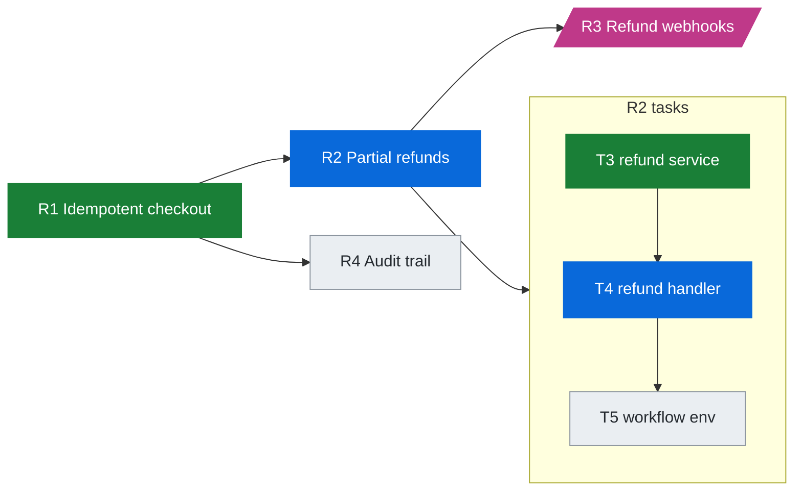
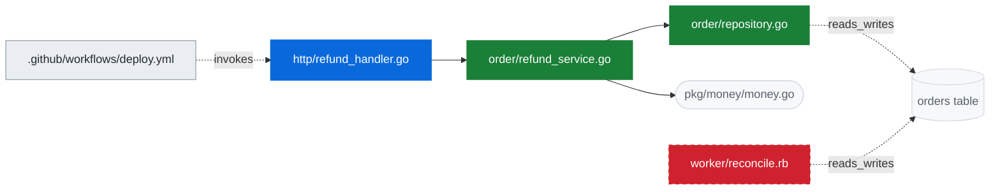
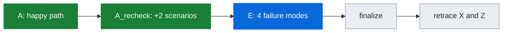
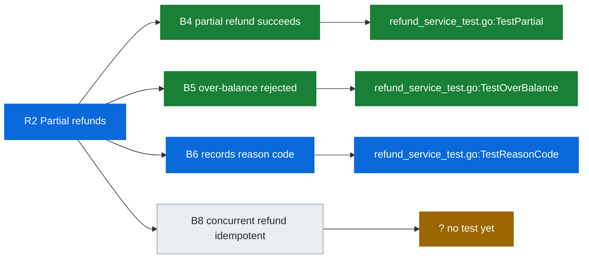
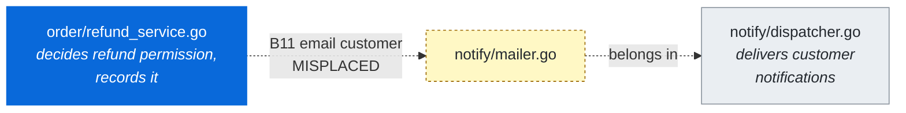
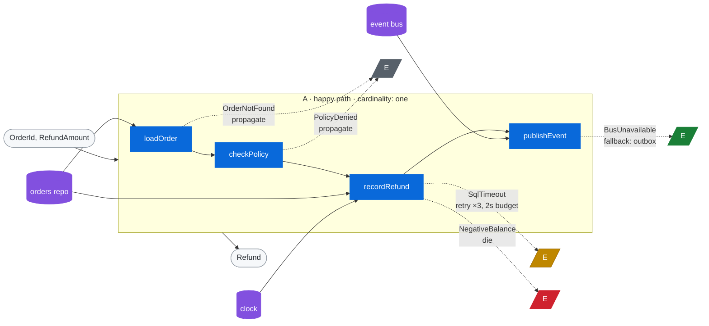
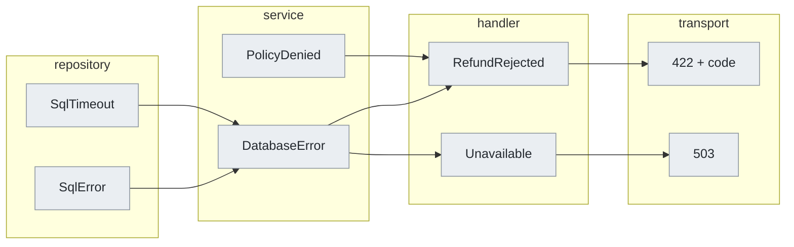
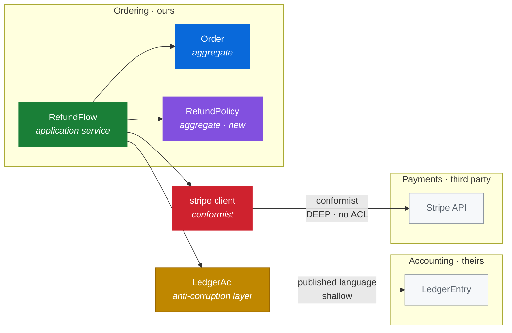
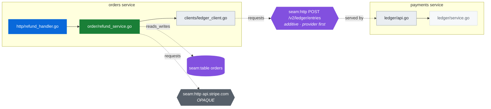
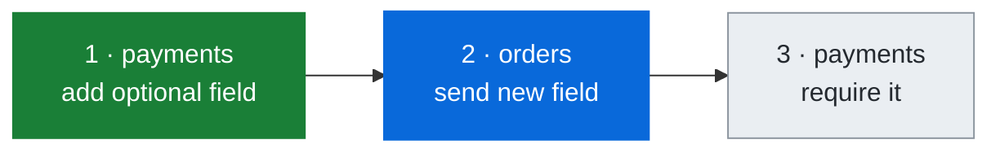

# Visualization

> **The graph-first rule is normative** (`principles.md` 31): status is reported
> as nodes, always. The specific glyphs, colors and Mermaid classes below are
> illustrative — keep the shape, change the styling to taste.


The diagram is a mirror of state, never a separate source of truth. Regenerate
`.design/<ref>.<task-slug>.graph.md` from the decision log's folds on **every state
write** — after a verdict, after a pass, after a drift outcome, after a
requirement closes. A stale diagram is worse than none, because the agent will
read it as current.

The artifact contains the views that apply to the current trace, in order:
task tier, current task's file graph, current node's passes, behavior
coverage, channels, context, seams, and deploy sequence. The status tree remains
the primary output; these views provide tier-specific evidence.

## The status graph — the primary output

**Report as a graph, always, and as a multi-level tree — not a flat list.**
Sibling bullets under a requirement hide who calls whom, which is the one thing
`X → Y → Z` exists to show. Emitted at every phase transition, before the first
edit, after each behavior closes, at every loop close, and on resume. Prose
explains the tree; it never replaces it. A paragraph describing what changed
with no graph is the one forbidden output format.

```
R2 partial refunds                              ◐  turn 2/3 · accept ✗
└─ T4 refund handler                            ◐  4/7 behaviors
   │
   ⋯> .github/workflows/deploy.yml      d-2  #6 ○  gate —
      │  deploy                                B9○
      └─→ http/refund_handler.go        d-1  #5 ◐  gate ✓
         │  Handle                             B7✓ B8◐
         ├─→ order/refund_service.go    d0 ★ #3 ✓  gate ✓
         │  │  RecordRefund                    B4✓ B5✓ B6✓
         │  │  A: load→policy→record→publish · one · 4E · 4R
         │  ├─→ order/repository.go     d+1  #1 ✓
         │  │  └─⇄ seam:table orders           #2 ✓ additive column
         │  ├─→ pkg/money/money.go      d+1     ⊘ absorbed · fan-in 47
         │  ├─⇉ seam:http /v2/ledger    d+1  #4 ✓ additive · provider first
         │  │  └─→ payments:ledger/api.go d+2    ✓ far side
         │  └─⊗ notify/mailer.go                  B11 → notify/dispatcher.go
         └─→ order/policy.go            d+1     ⊘ absorbed
   ↩ worker/reconcile.rb                d-1     ⚠ drifted a3f91c2 · re-triage
                                                  (also calls RecordRefund)

✗ accept: expected order status 'closed', got 'reopened'
  → units green, accept red: the delta missed a node, or R2 was misread
```

`✓ done · ◐ doing · ○ todo · ⊘ absorbed · ? unsure · ⊗ misplaced · ⚠ drift · — not gated`
`→ calls · ⋯> invokes · ⇉ requests · ⇄ reads/writes · ⊢ provisions · ↩ shared · ↺ cycle`
Legend once per conversation, not per report.

**One tree, five tiers.** Requirement, task, node chain, symbol, behaviors —
indentation is call depth, not category. The tree is rooted at the
entrypoint-most node reached, so it reads in the direction the system actually
runs; the seed is marked `★` because it is where the search landed, not where
the flow starts.

**Depth labels are signed relative to the seed.** `d-1` is a caller, `d+1` a
callee. Once nesting goes past two levels, indentation alone stops telling you
direction, and the sign restores it.

**Order markers are the edit plan.** `#1 #2 #3` are positions in the ordered
change set. Deep nodes carry low numbers because callees go first — so a node
numbered *lower* than its own parent is correct and expected, while a node
numbered higher than something it depends on is a sequencing bug the shape makes
visible.

**A shared node is expanded once.** Second and later parents get
`↩ path (expanded above)`. Expanding twice doubles the tree and hides that the
node is shared, and shared nodes are precisely the ones whose contract must not
change casually. Cycles get `↺` and are never followed.

**Detail goes where the motion is.** Levels: L0 requirement only, L1 with tasks,
L2 node tree (the default), L3 adds symbols, L4 adds behaviors, gates and
channels. Default output is L2 for the whole tree with the node in motion
expanded to L4. A full L4 tree of a real trace is unreadable and buries the one
node that matters.

**Draw the changed subgraph, not the whole trace.** Nodes that change, the path
connecting them, and one hop of absorption frontier. Everything else traced and
unaffected is *omitted* — not collapsed — behind a single line:
`⊕ 14 nodes traced, unaffected (L2-full to show)`.

The distinction that matters: an absorbed node **adjacent to a changing node** is
evidence of where the change stopped, and it stays drawn. An absorbed node three
hops away is just something the trace ruled out, and it does not earn a line
every time the graph is printed. The absorbed set only grows, and re-printing it
each turn teaches the reader to skim the whole thing.

**Subtrees still roll up** where they remain: finished siblings to
`✓ … ⊕ 4 nodes · 9 behaviors`, frontier siblings to `⊘ … ⊕ 3 absorbed`. Every
collapsed or omitted group states what it hides and how to see it — `L2-full`
draws everything traced, which is what a reviewer asking "why was that node
ruled out?" wants.

**Past a seam, keep nesting.** Far-side nodes carry their service prefix
(`payments:internal/ledger/api.go`) and hang off the seam node, since the seam
is what holds the contract.

Every status tree must show node status with its symbol, behavior ids and their
state (progress is behaviors closed, never files touched), gate state per node,
absorbed nodes with why, seams with compatibility and deploy order, drift and
misplacement marked so they cannot be skimmed past, and the loop turn with check
results. When a check is red, the expected-versus-observed line sits directly
under the tree — it is what the next decision turns on, and it routes two ways.

Everything below is the artifact form of the same information, written to
`.design/<ref>.<task-slug>.graph.md` — one per task — on every state write, plus
the derived `.design/index.md` across every model snapshot.

## Status vocabulary

One vocabulary across all tiers, so the classDefs are shared.

| Status | Meaning | Shape / marker |
|---|---|---|
| `done` | verified, closed | `[Text]` |
| `doing` | in progress now | `[Text]` + bold class |
| `todo` | traced, not started | `[Text]` |
| `no_change` | traced, deliberately untouched | `([Text])` |
| `unsure` | verdict unresolved | `{Text}` |
| `blocked` | waiting on something | `[/Text/]` |
| `drifted` | changed under us, needs revalidation | `[Text]` + dashed edge in |

## Header line

Always the first line of the file, so progress is readable without parsing the
diagrams:

```
R2/5 · T3/7 · behaviors 14/19 green · nodes 12 change / 9 no_change / 1 unsure
· 2 misplaced · 1 drifted · 3 seams (1 breaking) · commit a3f91c2
```

Behavior count leads the node count deliberately: green behaviors are progress,
touched files are not.

## Tier 0-1: requirements and tasks



Edges here are `depends_on`. Task order comes from this graph, not from the
ticket's bullet order.

## Tier 2: the current task's file graph

Direction is left-to-right so upstream sits left of the node in hand — the
`X -> Y -> Z` reading. Label edges with the edge kind whenever it is not
`calls`, since `invokes` and `reads_writes` are the ones that surprise people.



Rules that keep this readable:

- **Filename plus one parent directory only.** Full paths make the diagram
  unreadable at any real size; the state file has the full path.
- **`no_change` nodes stay in the diagram.** They are the evidence of where the
  change was absorbed, and hiding them loses the most useful review artifact.
- **Collapse high-fan-in nodes** into one marker node labelled with the count
  (`pkg/money (47 callers)`), never 47 nodes. Fan-in affects only how a node is
  drawn — it is not a stop condition and no longer a `stop_reason` value
  (principle 6b: count decides nothing, compatibility does).
- **Cap at ~25 nodes.** Past that, subgraph by package or by language and show
  only the packages on the current requirement's path.
- **Represent shared state as a cylinder** (`[(table)]`) so `reads_writes`
  edges have somewhere to land.

## Tier 3: the current node's passes

Only while a node is open. This is the pass tracker, and it is the fastest way
for the agent to answer "where was I."



## Tier 4: requirement to behavior coverage

The most useful diagram in the set, and the one to show the user at
`verify_requirement`. It makes an unsatisfied requirement impossible to miss,
because the chain simply does not reach a test.



Rules:

- **A behavior with no test node is a hole**, not a pending item. Render it
  reaching an `unsure`-classed `? no test yet` node so it reads as broken.
- **A requirement with no behaviors** gets rendered alone, with a note. That is
  the strongest possible signal that work was done but nothing was verified.
- **Pre-existing behaviors** (empty `requirement_ids`) belong in this diagram
  only when they are `no_change` regressions being protected — group them in a
  `subgraph regressions` so they do not crowd the new work.
- `B8` above shows the normal shape of a behavior found during `A_recheck`: it
  appears with no test, and the E pass closes it.

## Purpose labels and misplacement

Show a node's purpose in the tier-2 diagram only when it is doing work in the
argument — on the node in hand, and on any `MISPLACED` target. Everywhere else
it is noise.



A `misplaced` marker stays visible until its `resolution` is `moved` or
`purpose_widened`. If several accumulate on one node across a ticket, that node
is a `split_candidate` and the diagram is telling you so.

## Channel view: A with E and R annotated

The node-level design diagram, rendered at the end of `channels` and before any
test is written. A runs left to right as the spine; E branches off downward; R
attaches from below. Its whole job is to show whether the happy path is
readable on its own.



Rules:

- **A is the only solid path.** E branches are dashed and E nodes are colored by
  policy — retry amber, fallback green, propagate grey, die red. If the diagram
  looks cluttered with dashes, the node has too many break points and probably
  too many responsibilities.
- **Label every retry with its bound.** An unlabelled retry in the diagram is an
  unbounded retry in the code, and the diagram should make that impossible to
  miss.
- **R attaches from below, as cylinders.** A hidden R gets rendered in the
  `edie` class with a `hidden` label — it is the most valuable thing this
  diagram can surface, so it should look wrong.
- **Cardinality goes in the subgraph title.** `many` and `time_bounded` change
  how everything downstream reads.
- Boundary, layers and scope go in a caption line rather than as nodes, since
  they wrap the whole flow rather than sitting in it:

```
boundary: parsed at handler (RefundRequestDTO → domain) · layers: retry, tracing
· scope: db transaction, released on all paths
```

### Layer error scoping

Where a change crosses in-process layers, render the E vocabulary at each hop.
This is the diagram that catches leaking and collapsing.



Two shapes to look for: an arrow skipping a subgraph is **leaking** (a lower
layer's vocabulary reaching a higher caller unchanged), and two arrows merging
into one node is **collapsing** — fine when the caller genuinely should treat
both alike, a bug when it must tell them apart.

## Context map

Render this once per ticket, at the end of `language`, before any tracing. Its
job is to show predicted blast radius, so it is the diagram to argue about
early — it is the cheapest moment to discover that a change reaches a context
nobody expected.



Rules:

- **Label each foreign edge with the relationship and the predicted propagation
  depth.** That pair is the whole point of the diagram.
- **Render a conformist edge with no ACL in the risk class.** It is the shape
  where a foreign team's change propagates through your entire domain, and it
  should look alarming.
- **Show the ACL as a node between the contexts**, not as a label on an edge.
  It is the node that absorbs change, so `trace` will stop there and the
  diagram should show why.
- **Mark newly named concepts** (`RefundPolicy` above). A concept that had no
  name in the code until this ticket is worth a reviewer's attention — it is
  usually where the displaced rules were living.
- Aggregates, services, process managers and ACLs get distinct classes. Files do not appear
  in this diagram at all; that is the tier-2 view's job.

## Cross-service view

When a trace crosses a seam, group nodes into a subgraph per service and render
seams as the nodes between them. This is the diagram to show before any
cross-service change, because deploy order is impossible to reason about without
seeing both sides.



Rules:

- **Seams get their own shape**: hexagon `{{...}}` for a call seam, cylinder
  `[(...)]` for a state seam. They are not services and not files, and blurring
  them loses the thing that has the contract.
- **Label the seam with compatibility and deploy order**, not with its shape.
  `additive · provider first` is what a reviewer needs; the request body is in
  the artifact.
- **`OPAQUE` far sides render as a seam with no service behind it.** That
  visually marks where analysis genuinely stopped, as opposed to where it was
  abandoned.
- **One subgraph per service, ours leftmost.** Unreachable far sides get no
  subgraph at all.
- Keep this diagram to the seams on the current requirement's path. A full
  service map is a different document with a different purpose.

## Deploy sequence

Where a change spans services, render the rollout as a separate strip. Its only
job is to make the unsafe window visible.



Annotate any step where either rollout direction is unsafe — old consumer
against new provider, or new consumer against old provider. If a step is unsafe
in either direction, it needs splitting, and the diagram is the argument for
that.

## Drift markers

When `revalidate` finds drift, do not silently update the diagram. Mark the
node `drifted`, dash its incoming edges, and append a line under the header:

```
DRIFT: worker/reconcile.rb changed in a3f91c2..HEAD by @other — contract hash
mismatch on `reconcile_refunds` (deps added: RefundPolicy). Re-triage required.
```

The marker stays until the node is re-triaged. `invariant_broken` on a
`no_change` node is the serious one — that is a conflict with another author's
intent, not a test to fix, and it should be raised with the user rather than
resolved unilaterally.

## Plain-text fallback

When Mermaid will not render — a terminal, a PR comment, a log — use the
indented arrow form, which is also the right shape for a progress report:

```
R2 Partial refunds                              [doing]  4/5 behaviors green
  T4 refund handler                             [doing]
    http/refund_handler.go                      [doing]  A ✓ AR ✓ E … F …
      purpose: translates refund requests into service calls
      B4 partial refund succeeds                [green]  TestPartial
      B6 records reason code                    [red]    TestReasonCode
      B8 concurrent refund idempotent           [todo]   no test yet
      ← .github/workflows/deploy.yml            [todo]   invokes
      → order/refund_service.go                 [done]
        → order/repository.go                   [done]
          ⇄ orders table                        [no_change]
        → pkg/money/money.go                    [no_change] fan-in 47
        ⇉ seam:http POST /v2/ledger/entries     [todo]   additive, provider first
          → payments:ledger/api.go              [todo]   far side reachable
        ⇉ seam:http api.stripe.com/refunds      [OPAQUE] contract recorded
        → notify/mailer.go                      [MISPLACED] B11 → notify/dispatcher.go
    worker/reconcile.rb                         [DRIFTED] re-triage
```
